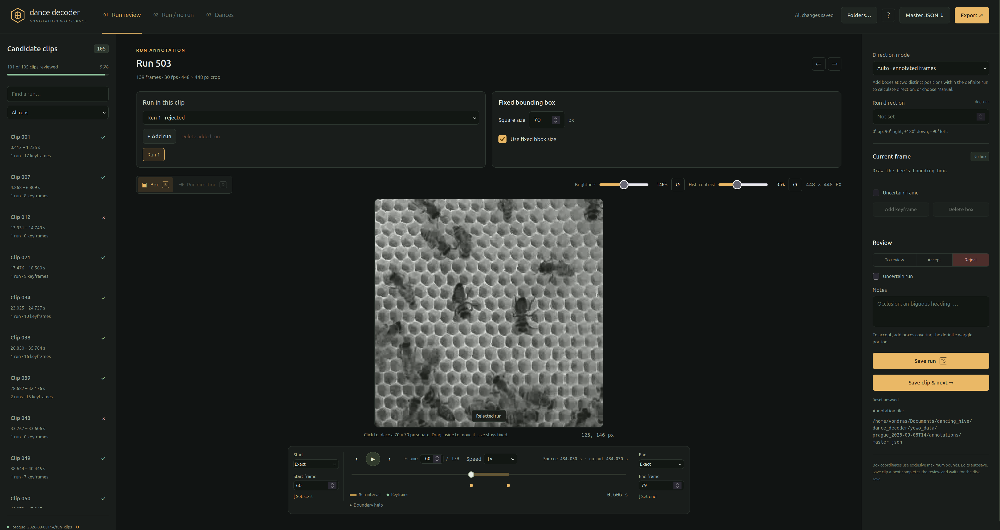
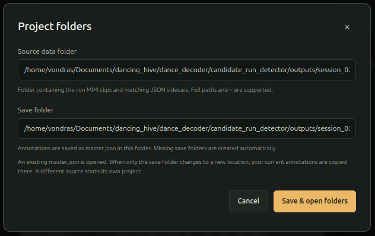
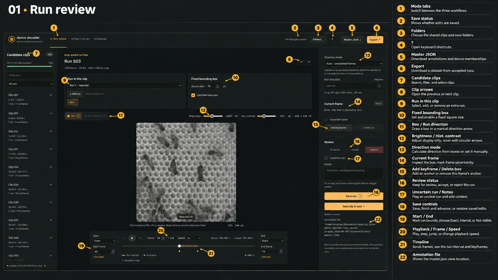
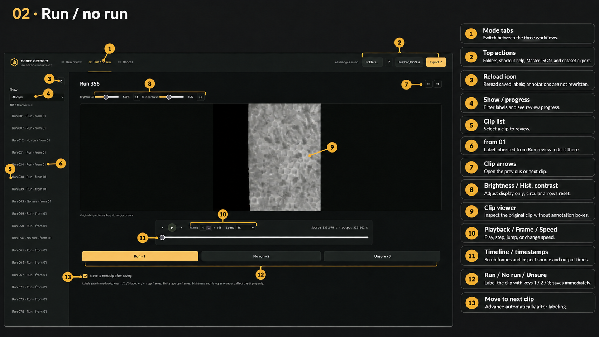
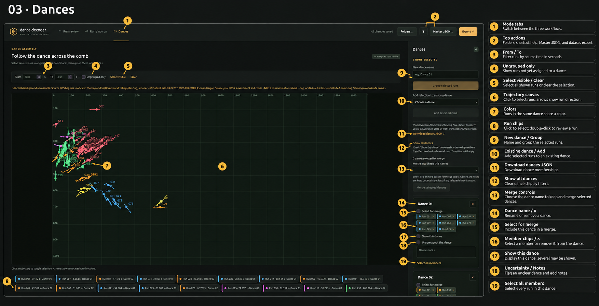

# Waggle dance annotation tool

A local browser tool for annotating waggle runs, labeling clips, and grouping runs
into dances. All three modes use one folder of MP4 clips with matching JSON
sidecars. Annotation is manual, with automatic box interpolation between keyframes
and run direction calculated from your annotated boxes.



## Start

From the parent directory containing `annotation_tool`:

```bash
conda create -n dance-annotation python=3.10
conda activate dance-annotation
conda install -c conda-forge opencv
python -m annotation_tool
```

Open [localhost:8765](http://localhost:8765). Stop the server with **Ctrl+C** in
its terminal. OpenCV is the only package you need to install explicitly; NumPy
is installed with it.

The default configuration loads the [example dataset](guide/example_dataset/).
Use **Folders** to choose your clips and annotation location:



Or specify the paths when starting the tool:

```bash
python -m annotation_tool --clips-dir path/to/run_clips --annotations path/to/annotations/master.json
```

Set startup defaults, including dataset and box size, in [config.py](config.py).
Restart after changing it; command-line options take precedence.

## 01 · Run review

Mark each run's start/end frames, box the bee, accept or reject the run.
Use **+ Add run** for multiple runs in one clip and **Save clip & next** to continue.

- **Boxes and interpolation:** draw freely or place fixed-size squares. Boxes
  interpolate linearly between keyframes; edit an intermediate box to add a
  correction. **Delete box** removes that keyframe and restores interpolation.
- **Automatic direction:** fits a principal axis (PCA) through annotated box
  centers in the definite run interval; first-to-last motion sets its direction.
  It updates when boxes or boundaries change and needs at least two distinct
  positions. Ambiguous motion leaves it unset. **Manual** lets you enter or draw
  an angle that stays fixed when boxes change. (Interpolated frames are not used
  in the calculation.)
- **Boundaries:** use exact endpoints, optional intervals between definite
  non-waggle and waggle frames, or **Not visible in clip** for a missing boundary.
- **Uncertainty:** flag individual frames or the whole run and add notes.
  Acceptance normally requires endpoint boxes and a direction; **Uncertain run**
  permits incomplete annotations.
- **Viewing:** adjust playback speed, brightness, and histogram contrast.
  Display adjustments do not change source images or exports.

<details open>
<summary>Annotated controls — Run review (click to enlarge)</summary>

[](guide/annotated/full/01-run-review.png)

</details>

## 02 · Run / no run

Quickly label large numbers of clips without detailed boxes or run boundaries.
Choose **Run**, **No run**, or **Unsure** with buttons or **1 / 2 / 3**; labels save
immediately. Labels marked **from 01** come from Run review (only when relevant) and are edited there.

<details>
<summary>Annotated controls — Run / no run (click to enlarge)</summary>

[](guide/annotated/02-run-no-run.png)

</details>

## 03 · Dances

Group related waggle runs into complete dances. Select accepted runs from Run
review on the map or list, then create a named dance or add them to an existing
one. Colors show which runs belong together. Filter by time, merge dances, add
notes or uncertainty flags, and download dance memberships as JSON.

<details>
<summary>Annotated controls — Dances (click to enlarge)</summary>

[](guide/annotated/03-dances.png)

</details>

The background warning visible in the Dances screenshot is from an older version.

## Saving and export

Edits autosave; check the header's save status before closing. Original clips and
sidecars remain unchanged.

| File | Contents / location |
| --- | --- |
| `master.json` | Run annotations and dances; defaults to `annotations/` beside the clips folder, or your selected save location. |
| `clip_labels.json` | Manual Run / no run labels; always in `annotations/` beside the clips folder. |

**Master JSON** downloads the combined run/dance annotations, including boxes in
crop and full-image coordinates and source/output timestamps.

**Export** creates a ZIP of crop images, normalized bounding-box labels
(class `0`: `waggle_bee`), `classes.txt`, `manifest.json`, and `master.json`.
Only accepted runs are eligible. Uncertain runs, frames, and boundary transitions
are excluded by default; the dialog can include them, export keyframes only, or
sample every Nth frame. Missing boxes and boxes held outside keyframes are never
exported.

**Shortcuts:** **Space** play/pause · **←/→** one frame · **Shift+←/→** ten frames ·
**[ / ]** run start/end · **B / D** box/direction tool · **Ctrl/Cmd+S** save.
